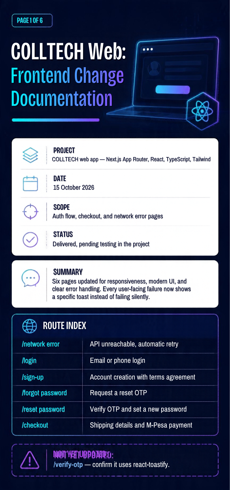
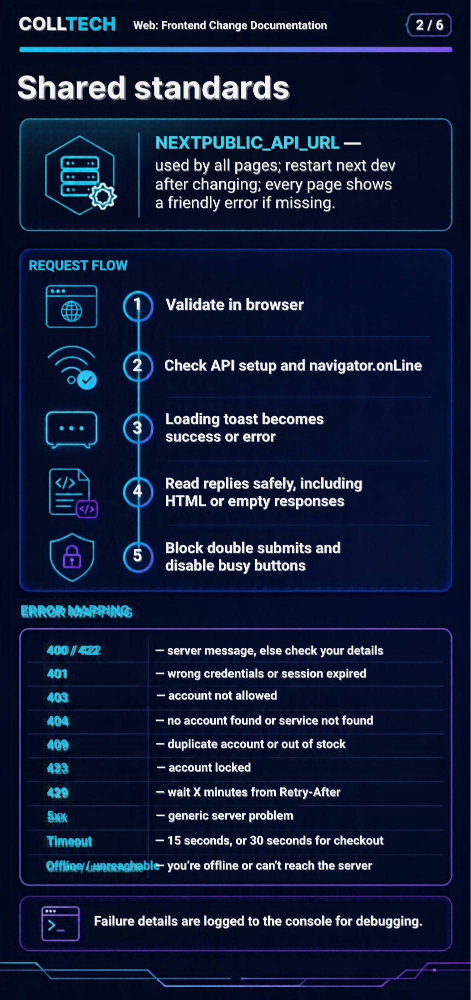
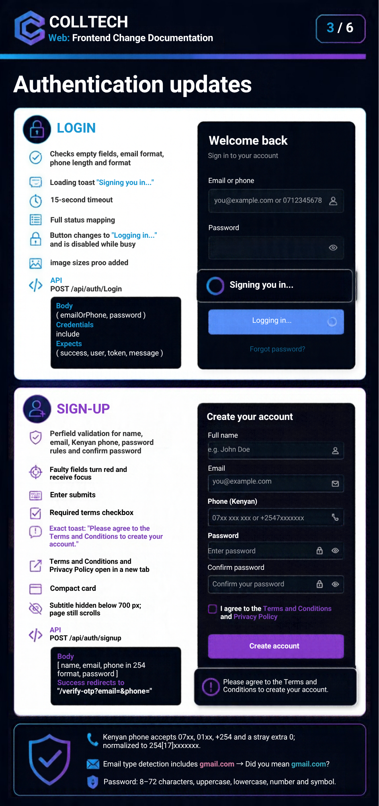
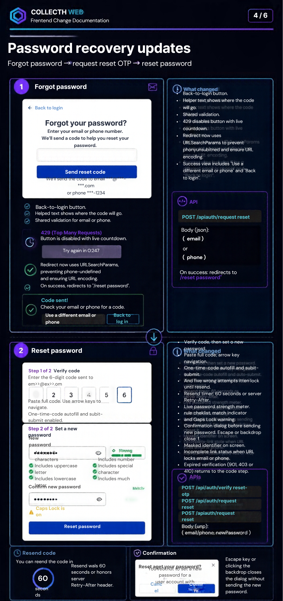
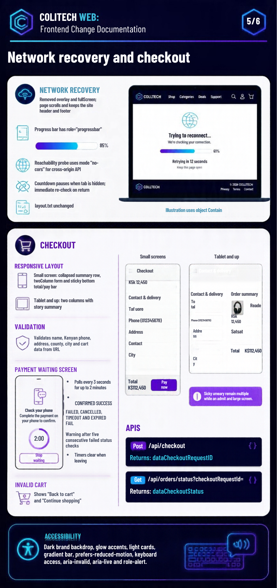
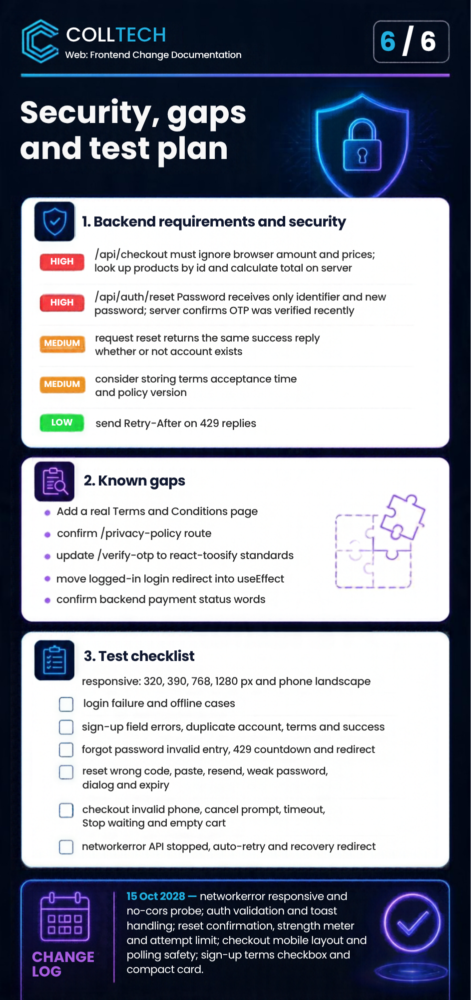

This is a [Next.js](https://nextjs.org) project bootstrapped with [`create-next-app`](https://nextjs.org/docs/app/api-reference/cli/create-next-app).

## Getting Started

First, run the development server:

```bash
npm run dev
# or
yarn dev
# or
pnpm dev
# or
bun dev
```

Open [http://localhost:3000](http://localhost:3000) with your browser to see the result.

You can start editing the page by modifying `app/page.tsx`. The page auto-updates as you edit the file.

This project uses [`next/font`](https://nextjs.org/docs/app/building-your-application/optimizing/fonts) to automatically optimize and load [Geist](https://vercel.com/font), a new font family for Vercel.

## Learn More

To learn more about Next.js, take a look at the following resources:

- [Next.js Documentation](https://nextjs.org/docs) - learn about Next.js features and API.
- [Learn Next.js](https://nextjs.org/learn) - an interactive Next.js tutorial.

You can check out [the Next.js GitHub repository](https://github.com/vercel/next.js) - your feedback and contributions are welcome!

## Deploy on Vercel

The easiest way to deploy your Next.js app is to use the [Vercel Platform](https://vercel.com/new?utm_medium=default-template&filter=next.js&utm_source=create-next-app&utm_campaign=create-next-app-readme) from the creators of Next.js.

Check out our [Next.js deployment documentation](https://nextjs.org/docs/app/building-your-application/deploying) for more details.
# COLLTECH Web

A modern technology platform for tech gadgets, printing and branding services, and a PS5 gaming lounge in Kenya.

---

## 📚 Technical Documentation

The following images provide the technical documentation for the COLLTECH Web application.













COLLTECH Web: Frontend Change Documentation
	
Project	COLLTECH web app (Next.js App Router, React, TypeScript, Tailwind)
Date	15 October 2026
Scope	Auth flow, checkout, and network-error pages
Status	Delivered, pending testing in the project (see section 7)
________________________________________
1. Summary
Six pages were updated for responsiveness, modern UI, and clear error handling. Every failure a user can hit (bad input, wrong password, server down, offline, timeout) now shows a specific toast message instead of failing silently.
Page	Route (assumed)	Purpose
network-error/page.tsx	/network-error	Shown when the API cannot be reached; auto-retries
login/page.tsx	/login	Email or phone login
sign-up/page.tsx	/sign-up	Account creation with terms agreement
forgot-password/page.tsx	/forgot-password	Request a reset OTP
reset-password/page.tsx	/reset-password	Verify OTP, then set a new password
checkout/page.tsx	/checkout	Shipping details and M-Pesa payment
Not yet updated: /verify-otp (check that it uses react-toastify, see 3.1).
________________________________________
2. Environment
Variable	Used by	Notes
NEXT_PUBLIC_API_URL	All pages	Backend base URL. Restart next dev after changing. Every page shows a friendly error if it is missing.
________________________________________
3. Shared standards (applied to every page)
3.1 Toasts
All pages use react-toastify. react-hot-toast was removed because it needs its own <Toaster /> and its toasts never appeared. Requires react-toastify v9 or newer (toast.loading and toast.update).
3.2 Request pattern
1.	Validate in the browser first (no request sent if input is bad).
2.	Check setup (API URL) and connection (navigator.onLine).
3.	Show a loading toast that turns into the success or error message.
4.	Read the reply safely (the server may return HTML or nothing).
5.	Block double submits; disable the button while busy.
3.3 Error mapping
Situation	Message behavior
Empty or invalid input	Specific message per field; field turns red and gets focus
400 / 422	Server message, else "check your details"
401	Wrong credentials (login) or "session expired"
403	Account not allowed (not verified, disabled)
404	"No account found" (or "service not found" if reply is not JSON)
409	Duplicate account / out of stock
423	Account locked (login)
429	"Wait X minutes" using the Retry-After header
5xx	Generic "server problem" (server text is not shown)
Timeout	After 15 s (30 s for checkout request)
Offline / unreachable	"You're offline" / "Can't reach the server"
Details of every failure are logged to the console for debugging.
3.4 Validation helpers (shared logic)
•	Kenyan phone: accepts 07xx, 01xx, +254, and a stray extra 0; normalized to 254[17]xxxxxxxx.
•	Email: format check plus common typo catch (gmial.com becomes a "Did you mean gmail.com?" message).
•	Password rules: 8 to 72 characters, with an uppercase letter, a lowercase letter, a number, and a symbol.
3.5 Design and accessibility
Dark brand backdrop with glow accents, light cards, brand gradient bar. prefers-reduced-motion respected, keyboard-accessible controls, aria-invalid, aria-live, and role="alert" on messages.
________________________________________
4. Page details
4.1 Network error (network-error)
•	Removed overlay and fullScreen: the page now scrolls and keeps the site header and footer.
•	Illustration is placed in a fill box with object-contain, so it scales without distortion.
•	Larger tile sizes on laptops (lg:); progress bar has role="progressbar".
•	Reachability probe uses mode: 'no-cors' for a cross-origin API (CORS no longer causes a false "Not responding").
•	Countdown pauses while the tab is hidden; an immediate re-check runs when the user returns.
•	layout.tsx unchanged.
4.2 Login (login)
•	Checks: empty fields, email format, phone length/format.
•	Loading toast "Signing you in…", 15 s timeout, full status mapping (3.3).
•	Button shows "Logging in…" and is disabled while busy.
•	Image given a sizes prop (removes the Next.js warning).
•	API: POST /api/auth/login, body { emailOrPhone, password }, credentials: 'include'. Expects { success, user, token, message }.
4.3 Sign-up (sign-up)
•	Per-field validation: name, email, Kenyan phone, password rules, confirm password.
•	Red highlight and focus on the faulty field; server messages that mention email/phone/password/name highlight that field.
•	Enter key submits.
•	Terms checkbox (required): unticked shows the toast "Please agree to the Terms and Conditions to create your account." and a red row. The links "Terms and Conditions" and "Privacy Policy" open the privacy page in a new tab (constants TERMS_PATH, PRIVACY_PATH).
•	More compact card; the subtitle is hidden on screens shorter than 700 px. The page still scrolls.
•	API: POST /api/auth/signup, body { name, email, phone (254 format), password }. On success, goes to /verify-otp?email=&phone=.
4.4 Forgot password (forgot-password)
•	Back to login button, helper text showing where the code will go.
•	Validation as in 3.4; 429 disables the button with a live countdown.
•	Fix: redirect link now built with URLSearchParams (no more phone=undefined, values are URL-encoded).
•	Success view has "Use a different email or phone" and "Back to login".
•	API: POST /api/auth/request-reset, body { email } or { phone }. Redirects to /reset-password.
4.5 Reset password (reset-password)
•	Two-step flow with a step indicator: verify code, then set password.
•	OTP: paste a full code, arrow-key navigation, one-time-code autofill, auto-submit, max 5 wrong attempts then lock until resend.
•	Resend timer (60 s, or the server's Retry-After on 429).
•	New password: live strength meter, rule checklist, match indicator, Caps Lock warning.
•	Confirmation dialog before the new password is sent (Escape or backdrop closes it).
•	Back to login button; masked email/phone on screen; "incomplete link" state when no email/phone is in the URL.
•	If the server says verification expired (401/403/410), the user is returned to the code step.
•	APIs: POST /api/auth/verify-reset-otp, POST /api/auth/request-reset (resend), POST /api/auth/reset-password with { email|phone, newPassword }.
4.6 Checkout (checkout)
•	Small screens: summary collapsed into one row, 2-column form, sticky bottom bar with total and pay button. From tablet size up: two columns with a sticky summary.
•	Validation: name, Kenyan phone (normalized for M-Pesa), address, county, city; cart data from the URL is validated.
•	"Check your phone" waiting screen with a 2:00 countdown and Stop waiting button.
•	Polling every 3 s for up to 2 minutes. Statuses: CONFIRMED is success; FAILED, CANCELLED, TIMEOUT, EXPIRED are failures. Warning after 5 failed status checks in a row. All timers are cleared when the user leaves the page.
•	Empty or invalid cart shows a friendly screen with "Back to cart" and "Continue shopping".
•	APIs (via fetchWithAuth): POST /api/checkout returns data.CheckoutRequestID; GET /api/orders/status?checkoutRequestId= returns paymentStatus.
________________________________________
5. Backend requirements and security notes
Priority	Item
High	/api/checkout must ignore the amount and prices sent by the browser. Look up products by id and calculate the total on the server (the cart is passed in the URL and can be edited).
High	/api/auth/reset-password receives only identifier and new password, with no OTP. It must confirm server-side that this account's OTP was verified recently.
Medium	Return the same success reply from /api/auth/request-reset whether or not the account exists (prevents email/phone enumeration). The UI works either way.
Medium	Consider storing terms acceptance (time and policy version) at sign-up. It is not sent today because a strict validator could reject the extra field.
Low	Send Retry-After on 429 replies so wait times are exact.
________________________________________
6. Known gaps and to-do
•	Add a real Terms and Conditions page (the current page contains only the Privacy Policy), then change TERMS_PATH in sign-up.
•	Confirm the privacy route (/privacy-policy assumed).
•	Update /verify-otp to match the standards in section 3.
•	Login redirects during render when already logged in; move it into useEffect when convenient.
•	Confirm payment status words used by the backend match 4.6.
________________________________________
7. Test checklist
•	[ ] Each page at 320, 390, 768, 1280 px and a phone in landscape
•	[ ] Login: wrong password, unknown account, empty fields, server stopped, offline
•	[ ] Sign-up: each field error, duplicate account, terms unticked, success to OTP page
•	[ ] Forgot password: invalid entry, 429 countdown, success redirect with correct query
•	[ ] Reset: wrong code (5 times), paste code, resend, weak password, confirmation dialog, expired verification
•	[ ] Checkout: invalid phone, cancel the M-Pesa prompt, wait for timeout, Stop waiting, empty cart link
•	[ ] Network-error: stop the API, confirm auto-retry and redirect back on recovery
________________________________________
8. Changelog
Date	Change
2026-10-15	Network-error page: responsive, scrollable, no-cors probe
2026-10-15	Login, sign-up, forgot, reset: full validation and toast handling
2026-10-15	Reset password: confirmation dialog, strength meter, attempt limit
2026-10-15	Checkout: mobile layout, sticky pay bar, payment polling safety
2026-10-15	Sign-up: required terms checkbox and compact card

